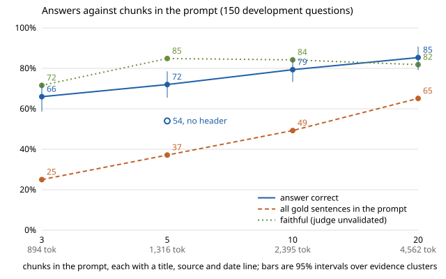

# Stage 8: Context assembly and prompt construction

One variable changes in this stage: what the generator is shown. The chunks (recursive, 128 tokens), the embedder (`text-embedding-3-small`), the retriever (hybrid, reciprocal rank fusion at 60), the reranker (Qwen3-Reranker-0.6B at depth 100) and the generator (`claude-sonnet-5-5`, effort low) stay as they were. Every row reads the same ranked list for each question; only how many of those chunks reach the prompt, which ones, in what form and in what order changes.

It is also the first stage that decides on answers rather than on retrieval, so every result below is answer correctness on the fixed 150-question development subset.

## Concept

**Retrieval gives a ranked list; the prompt needs a handful of passages.** Context assembly is the step in between. It answers four questions:

| Question | Options here |
|---|---|
| How many chunks? | 3, 5, 10 or 20 (the evaluator ranks 50) |
| Which ones? | the top k; the top k after dropping repeated text; k picked for diversity by maximal marginal relevance (MMR) |
| In what form? | each chunk on its own, or touching chunks of one article joined back into one passage; with or without a title, source and date line |
| In what order? | rank order; the two best at the ends ("lost in the middle"); articles oldest first |

**More context is a trade.** Each extra chunk is another chance to include a gold sentence, and another passage that looks relevant and is not (a distractor). Which side wins depends on the generator and on how much the question needs. Here a multi-hop question needs two to four sentences from different articles.

**Maximal marginal relevance.** Pick chunks one at a time; each next one maximises `λ · relevance − (1 − λ) · (highest similarity to a chunk already picked)`. λ = 1 is rank order; lower λ trades a relevant chunk for one that says something different. What it gives up is the second of two similar chunks, which is exactly what a comparison question about two articles on the same company can need.

**Headers.** A chunk is a slice of an article. The article's title, source and date are not in the slice. Stage 2 found what that costs: given the gold evidence sentences as bare text, the generator declined 80 of 100 comparison and temporal questions, because they ask about "the TechCrunch article" or "the report published on October 2", and nothing in the passages said which was which.

**Order.** Liu et al. (2023) found long-context models read the start and end of a prompt better than the middle. Later work on real retrieval (the plan's research notes, EMNLP 2025) found position effects small next to the damage distractors do. Chronological order is the third option because temporal questions ask what happened before or after.

## Options

| Decision | Options | Trade-off |
|---|---|---|
| Chunks in the prompt | 3, 5, 10, 20 | More evidence against more distractors, tokens and cost |
| Labels | none; title, source and date line | About 30 tokens per passage (28% more at 20 chunks) against attribution |
| Selection | top k; dedupe; MMR at λ 0.5–0.9 over 20 or 50 | Diversity against the second of two similar chunks |
| Form | one passage per chunk; touching chunks merged | One header and unbroken text against nothing (same text) |
| Order | rank; edges; chronological | Position effects against a reading order for time |
| Budget | a chunk count; a token budget | The experiment uses counts; the assembler supports both |
| Reranker for a short prompt | Qwen3; listwise `gpt-6-luna` (Stage 6); Qwen3 scoring decomposed questions (Stage 7) | Better top 5–10 for a model call or three reranking passes |
| Libraries | hand-written; LangChain `maximal_marginal_relevance` and `LongContextReorder` | See "Framework equivalent" |

## What we chose

**A context slot.** `PipelineConfig` has a `context` field that defaults to none, which builds the default assembler: the top `top_k` chunks in rank order with no header, byte for byte the prompt every earlier stage used. Every earlier config loads and runs unchanged, and its cached generator and judge calls stay valid: re-estimating `retr-hybrid-rrf-top25` and the Stage 2 gold row gives 0 new generator calls. Code: [context/](../../src/ragbasics/context/).

- [context/assemble.py](../../src/ragbasics/context/assemble.py): the assembler. Pool → dedupe → select (top k or MMR) → merge → header → token budget → order. Each step is off by default and reports what it did (duplicates dropped, chunks swapped in by MMR, chunks merged, passages over budget, tokens).
- [context/mmr.py](../../src/ragbasics/context/mmr.py): MMR in NumPy. Relevance is the reranker's score scaled to [0, 1] over the pool; similarity is the cosine of the chunks' stored vectors (`NumpyStore.vectors_for`).
- [context/prompts.py](../../src/ragbasics/context/prompts.py): `render_passages`, shared by the generator's prompt and the faithfulness judge, so the judge reads the headers the generator read. With a header, one sentence is added to the system prompt: "Each passage starts with a line giving the title, source and publication date of the article it comes from."
- `Passage` in [types.py](../../src/ragbasics/types.py): one or more chunks, its best rank and its header. Merging joins chunks only when their offsets touch or overlap, so a merged passage is the article's own text with nothing added and nothing hidden.

**The header line** is Stage 5's ("Title. TechCrunch, October 7, 2023.", the date written out the way questions write it), without the extra full stop after a title that already ends in "?". The retrieval indexes keep the Stage 5 form, so their cached scores hold.

**Free measurements first.** A retrieval-only run now scores the assembled prompt itself: whether it holds all the gold sentences (`context_full_support`), the share it holds (`context_recall`), and its size. [scripts/stage08_tune.py](../../scripts/stage08_tune.py) ran every selection setting on the pool questions and on development in 13 seconds with no model call (all reranker scores were cached), and decided which answer runs were worth paying for.

**Configs:** [configs/stage08_context/](../../configs/stage08_context/), one per answer run, named `ctx-*` so the retrieval-only run `rerank-qwen3-100` is not overwritten.

**The chosen settings: 20 chunks, each under a title, source and date line, repeated text dropped, touching chunks merged, rank order, no MMR** ([k20-header-merge.yaml](../../configs/stage08_context/k20-header-merge.yaml)). 87.3% correct, against 54.0% for the same retrieval with today's prompt and 51.3% for the Stage 1 baseline.

## Measured result

No predictions were written down for this stage.

150 development questions (63 comparison, 37 temporal, 32 inference, 18 null). Differences are paired, in percentage points, with 95% intervals from redrawing evidence clusters. Stage 2 measured the noise of asking twice at about ±4 points, so a difference inside that is called a tie and the cheaper setting wins. **Faithfulness is reported and not used:** the judge has not been checked against human labels (Stage 2), and you chose to keep those deferred. Regenerate with `python scripts/stage08_sweep.py --size 20 --write`; the numbers are in [results/stage08_context.csv](../../results/stage08_context.csv).

### Finding 1: the header is worth more than any retrieval change since Stage 5

Same 5 chunks, same order:

| Prompt | Correct | vs today's prompt | Temporal | Comparison | Inference | False abstentions | Declined with every gold sentence in the prompt | Prompt tokens |
|---|---|---|---|---|---|---|---|---|
| no header | 54.0 | | 16.2 | 39.7 | 100.0 | 50.8 | 18.2 | 1,053 |
| header | 72.0 | **+18.0 (+10 to +27)** | 45.9 | 66.7 | 96.9 | 25.0 | 1.5 | 1,316 |

And on the gold evidence, the row Stage 2 deferred to this stage:

| Gold sentences | Correct | vs no header | Temporal | Comparison | False abstentions |
|---|---|---|---|---|---|
| no header (Stage 2) | 46.0 | | 5.4 | 28.6 | 61.4 |
| header | 80.7 | **+34.7 (+26 to +46)** | 51.4 | 82.5 | 17.4 |

- **Temporal questions moved most**: +29.7 (+13 to +47) at 5 chunks, +45.9 on gold evidence. They name dates; without the header there is no date to read.
- **The header turned refusals into answers, not wrong answers into right ones.** Answerable questions declined fell from 67 to 33 of 132. The share declined *while every gold sentence was in the prompt* fell from 18.2% to 1.5%: the generator had the evidence and could not tell which article was which. Committed wrong answers rose from 2 to 9.
- An example, q_0789 (temporal, reference "no"): "Did Mashable report on the Echelon Connect Sport being on sale … before Fortune mentioned …?" Both gold sentences were in the 5 chunks. Without headers: "Insufficient information." With headers it compared the two dates and answered.
- **The reranker did not help answers until the header was there.** Qwen3 at 5 chunks without headers is +2.7 (−5 to +10) against the Stage 1 baseline, and −11.3 (−19 to −5) against hybrid retrieval with 25 chunks (Stage 5's answer run). Better retrieval put the evidence in the prompt; the generator still could not use it.
- **The gold-evidence row is now a usable reference**, and retrieval beats it: 20 retrieved chunks with headers score 85.3 against 80.7 for the gold sentences with headers, +4.7 (−3 to +13). The gold sentences are single sentences out of context ("It returned after dark"), and the 20 chunks bring the sentences around them.

### Finding 2: accuracy rises all the way to 20 chunks

All with headers, rank order:

| Chunks | Prompt tokens | Every gold sentence in the prompt | Correct | vs the size before | Temporal | Comparison | False abstentions | Cost per run |
|---|---|---|---|---|---|---|---|---|
| 3 | 894 | 25.0 | 66.0 | | 35.1 | 58.7 | 33.3 | $0.35 |
| 5 | 1,316 | 37.1 | 72.0 | +6.0 (+1.6 to +11.6) | 45.9 | 66.7 | 25.0 | $0.49 |
| 10 | 2,395 | 49.2 | 79.3 | +7.3 (+1.6 to +13.4) | 62.2 | 73.0 | 13.6 | $0.86 |
| 20 | 4,562 | 65.2 | 85.3 | **+6.0 (+0.9 to +11.2)** | 70.3 | 84.1 | 8.3 | $1.53 |

- **Each doubling is worth about 6–7 points, and each step's interval excludes 0.** 20 against 10 is +6.0, above the ±4 noise, so 20 was chosen.
- **The curve follows the evidence.** The share of questions with every gold sentence in the prompt goes 25 → 37 → 49 → 65; correctness tracks it about 20 points above (yes/no comparisons and the inference questions the model knows from memory, Stage 2, are answered without full support).
- **Distractors did cost something, just less than the evidence gained.** From 10 to 20 chunks, 14 answers went from wrong to right and 5 from right to wrong. Of those 5, two were hedges: the answer weighed the passages and ended with "Insufficient information."; two were comparisons where the extra passages tipped "no" to "yes". Answers also grew longer, from 48 output tokens at 5 chunks to 72 at 20, often bulleted despite "give the answer alone".
- **The peak is not found.** The curve is still rising at 20 chunks, about 2,750 tokens of passages. 30 or 40 chunks would answer where it stops; that was not in the approved run set (about $2.20 and $3.00 per run).
- **Faithfulness (unvalidated)** sits between about 72 and 85 with no trend in size; nothing here rests on it.

### Finding 3: order, merging and diversity are ties at 20 chunks

| Setting at 20 chunks | Correct | vs rank order | Temporal | vs rank order | Questions fixed / broken | Prompt tokens |
|---|---|---|---|---|---|---|
| rank order | 85.3 | | 70.3 | | | 4,562 |
| two best at the edges | 84.0 | −1.3 (−6 to +3) | 64.9 | −5.4 (−16 to 0) | 3 / 5 | 4,562 |
| articles oldest first | 86.0 | +0.7 (−2 to +4) | 73.0 | +2.7 (−7 to +13) | 4 / 3 | 4,562 |
| repeated text dropped, neighbours merged | **87.3** | +2.0 (−2 to +6) | 75.7 | +5.4 (0 to +15) | 6 / 3 | **4,282** |

- **Order does not matter for this model at 2,750 tokens.** Both alternatives are within a few questions of rank order. "Lost in the middle" was measured on much longer contexts and older models; at this length the generator reads everything. That matches the research note the plan cited.
- **Chronological order did not help temporal questions** beyond noise (+2.7, −7 to +13). The dates in the headers already did that work: the model compares dates; it does not need to read the articles in time order.
- **Dedupe and merge were chosen because they are free and cheaper, not because they win.** Merging turns 20 chunks into 15.3 passages on average, each with one header instead of several, so the prompt is 6% shorter (4,282 tokens against 4,562) for the same text. Dropping repeated text ("Advertisement", newsletter sign-ups, syndicated copies) finds 0.75 repeated chunks per question among the top 50, and refills their slots from below. The +2.0 is inside the noise.
- **MMR was not given an answer run.** The pre-agreed rule was to run it at the chosen size only if, on the pool, it raised context full support with an interval excluding 0. At 20 chunks no setting did (best: +0.0; λ 0.7 over 50 was −1.1, −2.7 to +0.4). See Finding 4.

### Finding 4: diversity selection finds nothing to fix here

Context full support against the top k, paired, from the free sweep ([results/stage08_tuning.csv](../../results/stage08_tuning.csv)):

| | Pool, 10 chunks | Development, 10 chunks | Pool, 20 chunks | Development, 20 chunks |
|---|---|---|---|---|
| plain | 48.6 | 51.7 | 60.6 | 63.7 |
| MMR λ 0.7 over 50 | +2.1 (+0.4 to +3.9) | +0.2 (−1.3 to +1.7) | −1.1 (−2.7 to +0.4) | +0.2 (−0.8 to +1.1) |
| MMR λ 0.5 over 50 | +0.3 (−3.7 to +3.9) | −1.1 (−5.0 to +2.1) | −2.1 (−5.4 to +0.7) | −1.1 (−3.3 to +0.9) |
| dedupe | 0.0 | 0.0 | +0.7 (0.0 to +2.1) | 0.0 |

- **The one pool gain did not hold on development**, the pattern Stage 7 saw: choosing the best of many settings on one question set finds a winner there.
- **Why MMR has little to do.** Behind Qwen3 the top 20 already spans 8.9 articles on average, and exact repeats are 0.4 chunks per question. MMR's job is to stop near-copies crowding out the second fact; Qwen3's ranking and the corpus leave few near-copies to remove. Stronger diversity (λ 0.5) hurts: it swaps in 3.4 chunks per question and loses evidence, because the second gold sentence for a comparison often reads like the first.

### Finding 5: the short-prompt reranker candidates close at 20 chunks

Full support of the top k on 441 development questions, from the Stage 6 and 7 retrieval runs (free), against Qwen3 at depth 100:

| Ranking | 3 | 5 | 10 | 20 |
|---|---|---|---|---|
| Qwen3-Reranker, depth 100 | 27.0 | 38.3 | 51.7 | 63.7 |
| listwise `gpt-6-luna`, depth 50 | +12.7 (+9 to +18) | +11.1 (+7 to +15) | +5.2 (0 to +10) | −0.7 (−5 to +3) |
| Qwen3 scoring decomposed questions, depth 50 | +5.7 (+2 to +10) | +5.2 (+2 to +9) | +3.6 (0 to +7) | −0.7 (−4 to +2) |

Both were open candidates for a prompt of 5 to 10 chunks. With 20 chunks chosen, both are level with Qwen3, so both are closed without an answer run. **If a deployment needs a short prompt** (latency, cost, a small context window), the listwise LLM reranker is the first thing to add: at 5 chunks it puts every gold sentence in the prompt for 11 more questions in 100.

### Framework equivalent

[framework_equivalents/context_assembly.py](../../framework_equivalents/context_assembly.py), behind the `frameworks` extra (now with `langchain-community` for the reorder):

- **MMR:** `langchain_core.vectorstores.utils.maximal_marginal_relevance` picks the same items in the same order as the hand-written `mmr` when relevance is the query cosine, at λ 0, 0.3, 0.5, 0.7 and 1 on five random clustered sets ([tests/test_context_parity.py](../../tests/test_context_parity.py)). The difference is the input: the library computes relevance as the query's cosine itself; the hand-written function takes any relevance, and here it is the reranker's score, the better signal (Stage 6). In a LangChain vector store MMR runs on the first stage's `fetch_k`, before any reranker.
- **Edge order:** `LongContextReorder` gives the same order as `order_edges` for 1 to 8 passages. Both put the best first with an odd count and last with an even count, which the library does not document.
- `langchain-community` warns on import that it is being sunset by its maintainers, one more reason to keep six lines of ordering code out of a dependency.
- Neither library merges neighbours, drops repeated text or writes headers; LlamaIndex has node post-processors for some of this and is not installed.

### New best config

**[configs/stage08_context/k20-header-merge.yaml](../../configs/stage08_context/k20-header-merge.yaml)**, run `ctx-k20-header-merge`: retrieval as `rerank-qwen3-100`, 20 chunks, title, source and date headers, repeated text dropped, touching chunks merged, rank order.

| Against | Correct |
|---|---|
| Stage 1 baseline (51.3) | +36.0 (+27 to +45) |
| hybrid retrieval with 25 chunks, Stage 5's answer run (65.3) | +22.0 (+15 to +29) |
| the same retrieval with today's 5-chunk prompt (54.0) | +33.3 (+25 to +42) |
| gold evidence with headers (80.7) | +6.7 (0 to +13) |

`BEST_RUN` for retrieval stays `rerank-qwen3-100`: this stage changed nothing that is retrieved. The report gains `BEST_ANSWER_RUN = "ctx-k20-header-merge"`, the answer run the next stage changes, and a "prompt tokens" column. Runs named `ctx-` appear only in the answer tables, since their retrieval is `rerank-qwen3-100`'s.

**Open items carried forward:** human labels for the judge (faithfulness still unvalidated; Stage 9 measures citation support and will need it); where the size curve peaks (30 and 40 chunks); 64-token chunks (to Stage 12's ablation, by your choice); the title, source and date header in the retrieval indexes (A1). **Closed:** the gold-evidence row with headers; the listwise LLM reranker and decomposed-question reranking for a short prompt (level at 20 chunks); MMR; ordering.

### Cost

Stage 8 spent $8.32, taking the project to $16.45 of $40:

| Run | Estimate | Billed |
|---|---|---|
| `ctx-k5` | $0.40 | $0.38 |
| `ctx-k5-header` | $0.47 | $0.49 |
| `ctx-k5-header-gold` | $0.23 | $0.25 |
| `ctx-k3-header` | $0.35 | $0.35 |
| `ctx-k10-header` | $0.78 | $0.86 |
| `ctx-k20-header` | $1.41 | $1.53 |
| `ctx-k20-header-edges` | $1.41 | $1.53 |
| `ctx-k20-header-chronological` | $1.41 | $1.53 |
| `ctx-k20-header-merge` | $1.27 | $1.39 |
| tuning sweep, estimates, tests | | $0 |

- The plan projected $7.79 for this path (20 chunks, no conditional runs). The longer prompts billed about 9% over their estimates because the estimate assumes 40 output tokens and answers at 20 chunks averaged 72.
- The chosen prompt costs about $0.009 per question at Sonnet 5.5's prices, against $0.0025 for today's 5-chunk prompt: about 3.8 times the cost for +33 points.

## When you would choose differently in production

- **Always label passages with where and when they come from**, whenever questions can name a source, a date or "the earlier report". Here it was worth 18 points at 5 chunks and 35 on gold evidence, for about 30 tokens a passage. It is also what makes a citation readable (Stage 9).
- **Measure the size curve with your generator.** With a strong long-context model and 128-token chunks, more context kept helping to 20 chunks. A smaller model, longer chunks or a noisier corpus moves the peak down; the plan's research notes found distractors are what hurt.
- **A short prompt needs a better top of the list.** Below 10 chunks the listwise LLM reranker found 11 more full supports in 100 than Qwen3. Pay for it when latency, cost per question or the context window caps the prompt.
- **Count the bill per question.** The chosen prompt costs about 3.8 times today's 5-chunk prompt. At high volume, 10 chunks (79.3%, $0.0055 a question) may be the better point; with prompt caching the fixed system prompt is small here, so caching saves little.
- **Merge neighbours and drop repeats as hygiene**: they cost nothing, shorten the prompt and read better, even when the answer metric cannot see them.
- **Reach for MMR when the corpus has near-duplicates** (syndicated news, versions of one document, templated pages) and the ranker does not separate them. Tune λ on held-out questions and keep it high; at λ 0.5 it threw away evidence.
- **Do not reorder for "lost in the middle" without measuring it** on your context length and model. At 2,750 tokens it made no difference here.
- **Watch what more context does to refusals.** Here it turned refusals into answers, and committed wrong answers rose from 2 to 11 between today's prompt and the chosen one. Whether that trade is right is the abstention question of Stage 9.

## Questions you should now be able to answer

1. Why did the reranker add almost nothing to answer correctness until the header was added?
2. Why can more context lower accuracy, and why did it not here?
3. What does maximal marginal relevance trade away, and why did it find nothing to fix behind Qwen3?
4. Does chunk order matter for this model? What would change your answer?
5. Why did 20 retrieved chunks beat the gold evidence sentences?
6. Why were merging and deduplication chosen when their gain was inside the noise?
7. When would you revisit the listwise LLM reranker?

Short answers

1. The questions name sources and dates, and bare chunks carry neither. With the evidence in the prompt the generator still could not tell which passage was which and declined: 18% of answerable questions were declined with every gold sentence present. The header cut that to 1.5%.
2. Each extra chunk can be a distractor that looks relevant and points to a wrong answer or a hedge. Here each doubling added about as much evidence (full support +12 to +16 points) as it added distractors, and the generator is good at ignoring passages it does not need: 14 answers fixed and 5 broken from 10 to 20 chunks.
3. The second of two similar chunks. It helps when near-copies crowd out a second fact. Behind Qwen3 the top 20 already spans about 9 articles with under one exact repeat per question, and the second gold sentence of a comparison often resembles the first, so stronger diversity removed evidence.
4. No: at 20 chunks and about 2,750 tokens, best-at-the-edges and chronological order were within 1.3 points of rank order. A much longer context, a weaker model, or questions that depend on reading order could change it; measure on your own length.
5. The gold sentences are single sentences cut out of context, and some only make sense with the sentence before. The 20 chunks hold most of the same sentences plus their neighbours, and more of each article's wording.
6. They cost nothing, change no text, and make the prompt 6% shorter. Under the rule set before the runs, a tie goes to the cheaper setting.
7. When the prompt must be short (5 to 10 chunks): there it found 11 more full supports in 100 than Qwen3 at 5 chunks. At 20 chunks the two are level.

